<div align="center">

<a href="https://bigwoo.github.io/skyrig-builder/">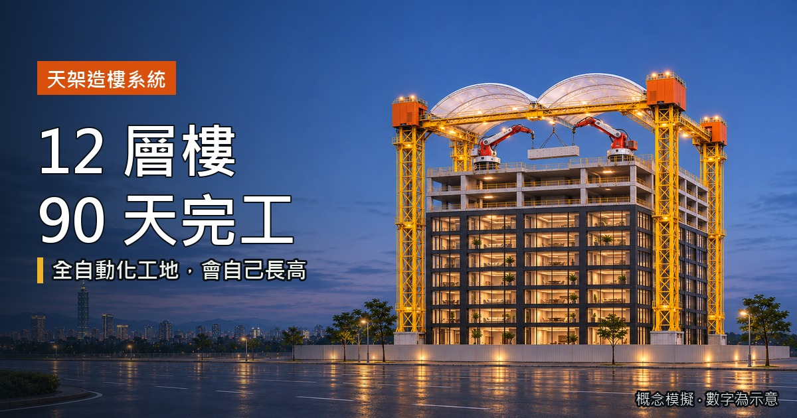</a>

# SkyRig Builder · 天架造樓系統

**What if the construction site itself were a machine that never stops and grows with the building?**<br>
一座 24 小時不停工、會跟著大樓一起長高的全自動化工地。

[](https://bigwoo.github.io/skyrig-builder/)
[](https://bigwoo.github.io/skyrig-builder/intro.mp4)
<br>


[English](#english) · [繁體中文](#繁體中文)

</div>

---

<a id="english"></a>

## 12 storeys, 90 days, one machine

<p align="center">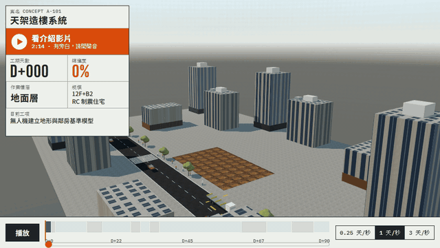</p>

Building a tower is slow for reasons that have little to do with concrete. Crews can only work part of the day, sites sit idle for long stretches, and one late task pushes back everything behind it.

SkyRig turns the site into a single automated system. An AI reads the drawings and builds the whole tower virtually before day one, a factory casts the structure off site, and a self-climbing rig assembles it floor by floor around the clock, then lowers itself and leaves for the next job.

This repository is an **interactive 3D simulation** of that idea: a 12-storey seismic-damped residential tower (12F + B2) built from an empty lot to handover in 90 days, in a browser.

| | | | |
|:-:|:-:|:-:|:-:|
| **90** days, lot to handover | **2** days per floor | **24 h** day–night relay | **10** telescoping columns |
| **3,288** placed components | **1,072** scheduled lifts | **238** robot timelines | **10** what-if scenarios |

## How SkyRig works

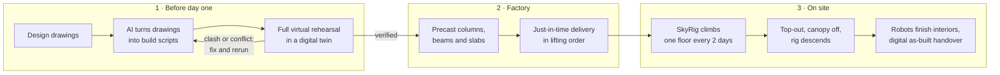

1. **Rehearse before you build.** The AI turns the drawings into scripts for every arm and robot, runs the full 90 days in a digital twin, and fixes clashes and sequencing conflicts before anything happens on site.
2. **Cast in the factory, assemble on site.** Columns, beams, slabs and façade panels are precast and cured off site, then trucked in exactly in lifting order, so the street never queues and nothing is stockpiled.
3. **A rig that climbs with the building.** Ten telescoping columns stand on the diaphragm wall. Each time a floor is finished the rig jacks up one storey and anchors back into the new slab, so it gets steadier as it gets taller.
4. **Two rings, two kinds of arms.** The upper ring carries heavy gantries with telescopic arms that lift precast members; the lower ring carries light arms that install seismic dampers and façade panels two floors behind.
5. **Open, not boxed in.** Only a see-through mesh and a retractable canopy enclose the deck. People on the street can watch progress, and falling objects are still caught.
6. **Leave, then reuse.** After top-out the canopy comes off, the rig lowers itself while patching anchor holes, and its column segments go back to the factory for the next project. Humanoid and specialist robots finish the interiors.

### The 90-day schedule

| Days | Phase | Days | Phase |
|---|---|---|---|
| 0–2 | Factory precasting starts (runs in parallel) | 33–36 | Basement precast assembly |
| 2–3 | Drone survey and digital setting-out | 36–62 | Superstructure: 2-day floor cycle and dampers |
| 3–13 | Diaphragm walls | 62–70 | Façade close-out, canopy removal |
| 13–18 | Piles | 70–78 | Rig descends and is recovered |
| 18–27 | Automated excavation and strutting | 78–85 | Interiors and systems commissioning |
| 27–30 | SkyRig assembly | 85–90 | Landscaping and handover |
| 30–33 | Raft foundation | | |

## Explore the simulation

<table>
<tr>
<td width="50%">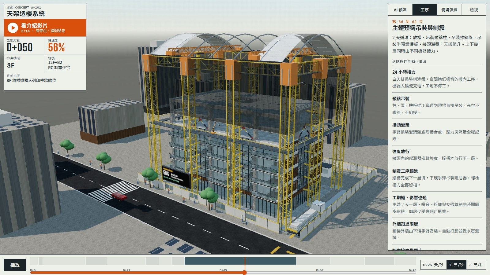</td>
<td width="50%">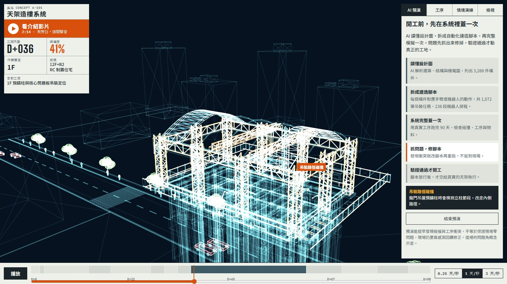</td>
</tr>
<tr>
<td><b>Scrub all 90 days.</b> Drag the timeline or press play. The side panel explains what is being automated in each phase, and any part or machine can be clicked to see what it does.</td>
<td><b>AI rehearsal.</b> Switch to the digital twin and watch the system build the tower virtually, stop at each clash or sequencing conflict, fix the script, and only then release it to site.</td>
</tr>
<tr>
<td>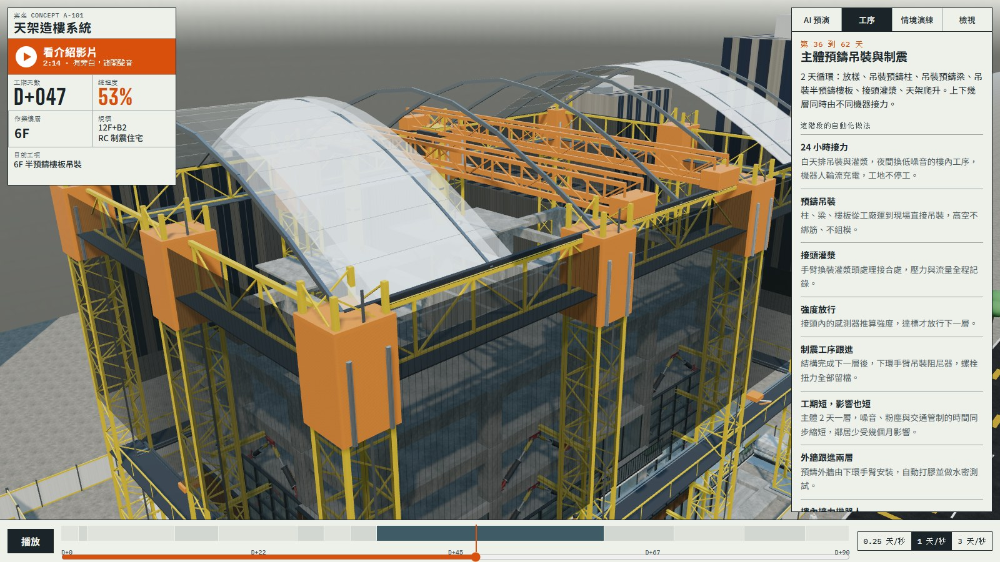</td>
<td>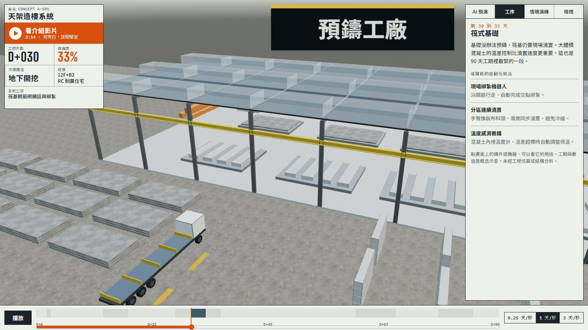</td>
</tr>
<tr>
<td><b>Seven cameras.</b> Overview, factory, street level, working deck, rig top, inside the floors and the excavation pit, plus a guided tour that follows each phase.</td>
<td><b>The factory is part of the site.</b> Follow components from the casting line to the yard, onto autonomous trucks and along the route to the hook.</td>
</tr>
<tr>
<td>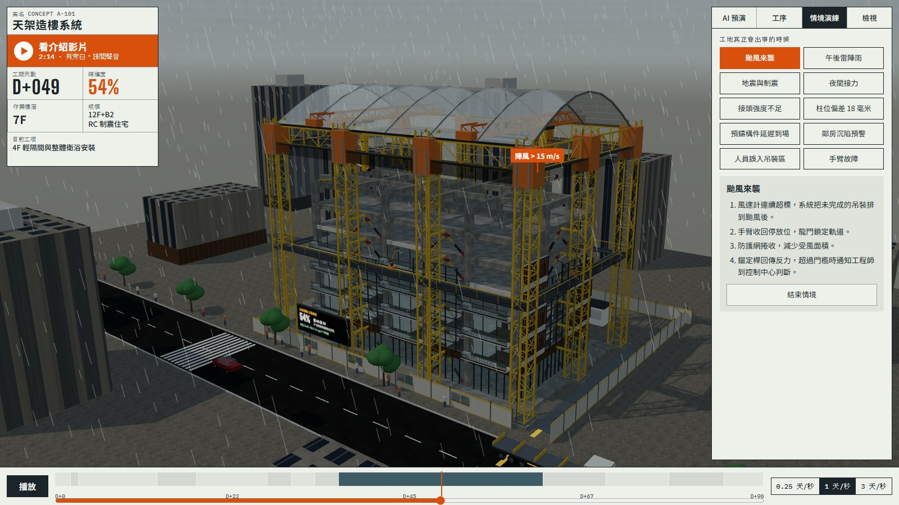</td>
<td>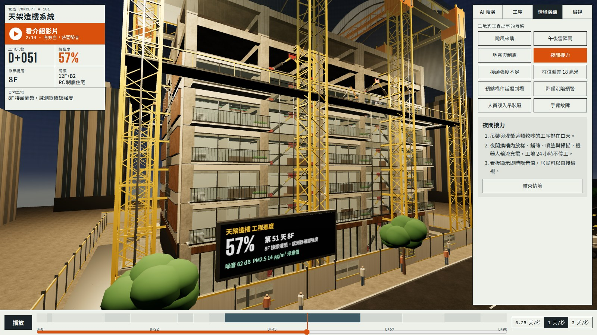</td>
</tr>
<tr>
<td><b>What-if scenarios.</b> Typhoon, afternoon thunderstorm, earthquake and damping, night shift, weak joint, 18 mm column deviation, late delivery, neighbour settlement, person in the lifting zone and robot-arm failure. Each one shows how the system responds, step by step.</td>
<td><b>A better neighbour.</b> Low-noise work moves to night, a street-side board shows floor, task, noise and dust in real time, and a shorter programme means months less disruption.</td>
</tr>
<tr>
<td>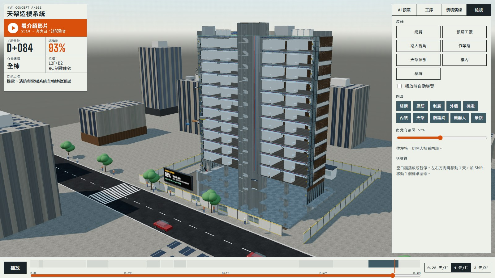</td>
<td align="center">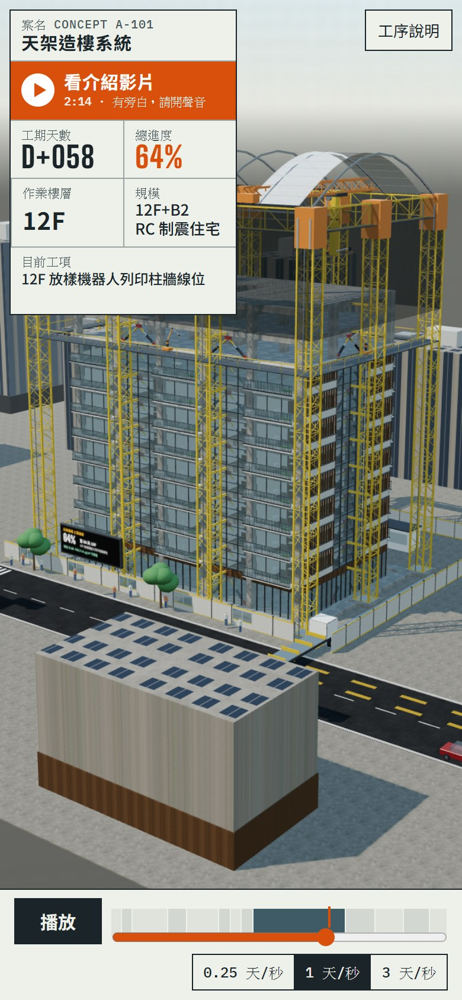</td>
</tr>
<tr>
<td><b>Look inside.</b> Cut the tower open with a section plane and toggle ten layers: structure, rebar, dampers, façade, MEP, interiors, rig, net, robots and landscape.</td>
<td><b>Works on phones.</b> The layout adapts to portrait and landscape screens, and a built-in 2-minute narrated film introduces the idea.</td>
</tr>
</table>

**Keyboard:** <kbd>Space</kbd> play or pause · <kbd>←</kbd> <kbd>→</kbd> one day · <kbd>Shift</kbd> + <kbd>←</kbd> <kbd>→</kbd> one 2-day floor cycle

## Under the hood

- **Procedural model.** A Blender 5.2 Python script generates the whole site: 102 part types placed 3,288 times, about 445,000 triangles, plus a 90-day schedule with 1,072 lifting tasks and 238 robot timelines. Everything is exported as one GLB and one JSON file.
- **Time lives on the GPU.** Each instance carries its own appear and remove time. Parts are drawn with `InstancedMesh`, and a custom shader reveals them against a single time uniform, so scrubbing 90 days never rebuilds the scene.
- **One source for the site and the film.** The intro film was captured frame by frame from this same simulation under a virtual clock with Playwright, then narrated, subtitled and encoded with ffmpeg.
- **No build step.** Plain ES modules and Three.js from a CDN. Clone it and serve the folder.

```bash
git clone https://github.com/BIGWOO/skyrig-builder.git
cd skyrig-builder
python -m http.server 8000   # then open http://localhost:8000
```

Requires a browser with WebGL2.

| File | What it holds |
|---|---|
| `index.html` | Layout, styles and UI shell |
| `app.js` | Scene, time engine, camera director, tour, AI rehearsal and scenarios |
| `content.js` | Phase notes, scenarios, cameras, layers and tour text |
| `schedule.json` | Phases, rig climbing keys, instances, lifting tasks and robot timelines |
| `parts.glb.txt` | The 102 part meshes (base64 GLB) |
| `intro.mp4` | The 2-minute narrated introduction |

> [!NOTE]
> SkyRig is a concept. The schedule, quantities, scenarios and AI rehearsal are illustrative and have not been checked by cost estimates, structural analysis or a real construction programme.

---

<a id="繁體中文"></a>

## 繁體中文

### 12 層樓，90 天，一台機器

蓋大樓慢，常常不是慢在混凝土。人力一天能施工的時間有限，工地有大半時間是停著的，只要一關卡住，後面全部跟著延。

天架把整個工地變成一套自動化系統：開工前，AI 先讀懂設計圖，在系統裡完整蓋一次；主要構件在工廠預鑄；會爬升的天架 24 小時接力，一層一層組起大樓；完工後天架自己降下來，帶去下一個工地。

這個專案是這套構想的**互動 3D 模擬**：一棟地上 12 層、地下 2 層的制震住宅，從空地到交屋共 90 天，全部在瀏覽器裡呈現。

| | | | |
|:-:|:-:|:-:|:-:|
| **90** 天從空地到交屋 | **2** 天蓋一層 | **24 小時**日夜接力 | **10** 支伸縮立柱 |
| **3,288** 件構件 | **1,072** 筆吊裝任務 | **238** 段機器人排程 | **10** 種情境演練 |

### 天架怎麼運作

1. **先預演再開工：** AI 把設計圖拆成每支手臂與機器人的建造腳本，在數位雙生裡跑完 90 天。碰撞和工序衝突先抓出來修掉，驗證通過才動真正的工地。
2. **工廠預鑄，工地組裝：** 柱、梁、樓板與外牆在工廠預鑄、養護達標才出廠，再依吊裝順序準時送到工地。到了就吊，街道不用排車，現場也不囤料。
3. **跟著大樓長高：** 10 支伸縮立柱站在連續壁上。每完成一層，天架就頂升一層，並錨回剛完成的樓板，愈蓋愈穩。
4. **上下兩環，兩種手臂：** 上環的重型龍門與伸縮臂負責吊裝預鑄構件，下環的輕型手臂晚兩層跟進，安裝阻尼器與外牆。
5. **不封閉的工地：** 作業層只圍透光防護網和可開闔的頂棚，路人看得到進度，墜物也擋得住。
6. **拆下來再用：** 封頂後先拆頂棚，天架一路下降，邊降邊修補錨定孔，立柱節段送回工廠，下一個案子繼續用。室內裝修交給人形機器人和裝潢專屬機器人分工完成。

### 90 天工期

| 天數 | 階段 | 天數 | 階段 |
|---|---|---|---|
| 0–2 | 工廠預鑄（全程並行） | 33–36 | 地下室預鑄吊裝 |
| 2–3 | 基地整備與數位放樣 | 36–62 | 主體預鑄吊裝與制震，2 天一層 |
| 3–13 | 連續壁 | 62–70 | 外牆收尾與頂棚拆除 |
| 13–18 | 基樁 | 70–78 | 天架下降與回收 |
| 18–27 | 自動開挖與支撐 | 78–85 | 內裝與系統測試 |
| 27–30 | 天架組立 | 85–90 | 景觀與交屋 |
| 30–33 | 筏式基礎 | | |

### 可以怎麼玩

- **拖曳 90 天時間軸：** 拖曳時間軸或直接播放；側欄說明每個階段的自動化做法，點畫面上任何構件或機器都能看到它的用途。
- **AI 預演：** 切換到數位雙生模式，看系統虛擬蓋完整棟樓，遇到碰撞或工序衝突就停下來修腳本，通過後才放行到工地。
- **七種鏡頭：** 總覽、預鑄工廠、路人視角、作業層、天架頂部、樓內和基坑，還有跟著工序走的自動導覽。
- **情境演練：** 颱風來襲、午後雷陣雨、地震與制震、夜間接力、接頭強度不足、柱位偏差 18 毫米、預鑄構件延遲到場、鄰房沉陷預警、人員誤入吊裝區和手臂故障，逐步呈現系統怎麼應對。
- **剖面與圖層：** 用剖面切開大樓，並開關結構、鋼筋、制震、外牆、機電、內裝、天架、防護網、機器人和景觀十個圖層。
- **手機也能看：** 直式和橫式畫面都有對應版面，內建 2 分鐘的旁白介紹影片。

**快捷鍵：** <kbd>空白鍵</kbd> 播放或暫停 · <kbd>←</kbd> <kbd>→</kbd> 移動 1 天 · <kbd>Shift</kbd> + <kbd>←</kbd> <kbd>→</kbd> 移動一個 2 天標準循環

### 技術做法

- **程序化建模：** 用 Blender 5.2 的 Python 腳本生成整個工地，包含 102 種零件、3,288 件構件、約 44.5 萬個三角面，以及 1,072 筆吊裝任務和 238 段機器人排程，輸出成一個 GLB 和一個 JSON。
- **時間交給 GPU：** 每件構件都記錄自己的出現與移除時間，用 `InstancedMesh` 繪製，再由自訂 shader 依同一個時間值決定顯示，拖曳 90 天時間軸不必重建場景。
- **網頁和影片同一個來源：** 介紹影片用 Playwright 在虛擬時鐘下逐幀錄製這個模擬，再配上旁白、字幕，用 ffmpeg 輸出。
- **不需要建置：** 純 ES modules，Three.js 從 CDN 載入，下載後用任何靜態伺服器就能執行。

> [!NOTE]
> 天架是概念專案。工期、數量、情境與 AI 預演都是示意，未經成本估算、結構分析或實際施工計畫驗證。

<div align="center">
<br>

**Concept and direction by [BIGWOO](https://github.com/BIGWOO)**

</div>
